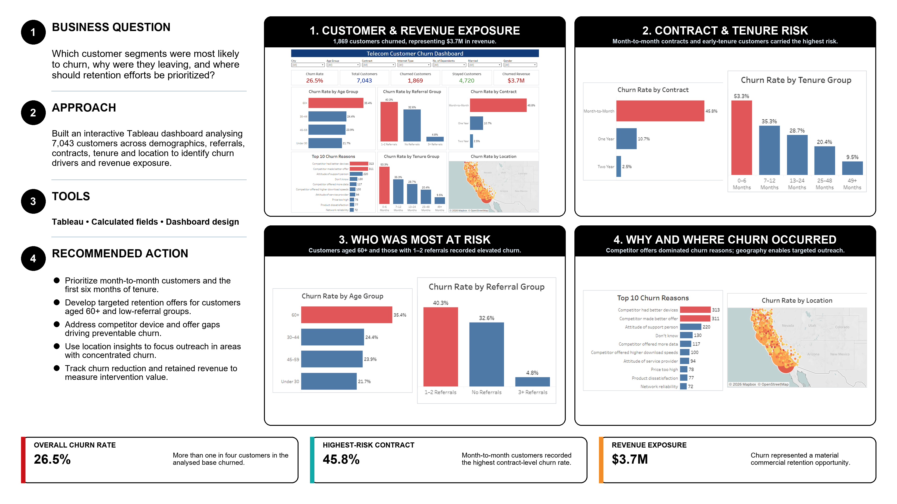

# Telecommunications Customer Churn Dashboard

## Executive summary

This Tableau portfolio project analyzes customer churn across demographics, contracts, tenure, referrals and geography. It demonstrates how an interactive dashboard can help retention stakeholders prioritize high-risk segments and address preventable drivers of revenue loss.



## Business question

Which customer segments were most likely to churn, why were they leaving and where should retention efforts be prioritized?

## Stakeholder requirements

- Quantify overall churn and associated revenue exposure.
- Identify the contract, tenure and demographic segments with elevated churn.
- Determine the most frequently reported reasons for leaving.
- Enable users to filter the dashboard by customer characteristics.
- Translate the analysis into practical retention priorities.

## Dashboard

[View the interactive Tableau dashboard](https://public.tableau.com/views/TelecomChurnDasboard_17910850504150/TelecomsDashboard)

## Dataset

- 7,043 customers analyzed
- 1,869 churned customers
- 4,720 stayed customers
- `$3.7M` in churned revenue represented in the dashboard

Dataset definitions and source attribution are documented in [`data/data_dictionary.md`](data/data_dictionary.md).

## Tools used

- Tableau
- Calculated fields
- Customer segmentation
- Dashboard design

## Analytical approach

1. Validated customer, churn and revenue fields.
2. Created calculated measures for churn rate and customer status.
3. Segmented customers by contract, tenure, age, referrals and location.
4. Ranked the reported churn reasons.
5. Built interactive filters for stakeholder exploration.
6. Converted the findings into targeted retention recommendations.

## Key insights

- Overall churn was `26.5%`.
- Month-to-month customers recorded the highest contract-level churn rate at `45.8%`.
- Customers in their first 0–6 months recorded a churn rate of `53.3%`.
- Customers aged 60+ recorded elevated churn at `35.4%`.
- Customers with 1–2 referrals recorded `40.3%` churn, compared with `4.8%` among customers with 3+ referrals.
- Competitor devices and competitor offers were among the most frequently reported churn reasons.

## Recommendations

1. Prioritize month-to-month customers and customers in their first six months.
2. Develop targeted retention offers for customers aged 60+ and low-referral groups.
3. Address competitor device and offer gaps that contribute to preventable churn.
4. Use geographic insights to focus outreach in areas with concentrated churn.
5. Track churn reduction and retained revenue to measure intervention value.

## Repository structure

```text
telecom-customer-churn-dashboard/
├── data/
│   ├── telecom_customer_churn.csv
│   └── data_dictionary.md
├── visuals/
│   └── telecom-customer-churn-poster.png
└── README.md
```

## Limitations

- The analysis identifies associations rather than causal effects.
- Revenue exposure does not equal revenue that would necessarily be recovered through an intervention.
- Recommended actions should be validated through controlled retention tests.

## Author

**Joy Ezike** — [Portfolio](https://joy-ezike.my.canva.site/) | [LinkedIn](https://www.linkedin.com/in/joy-ezike/)
